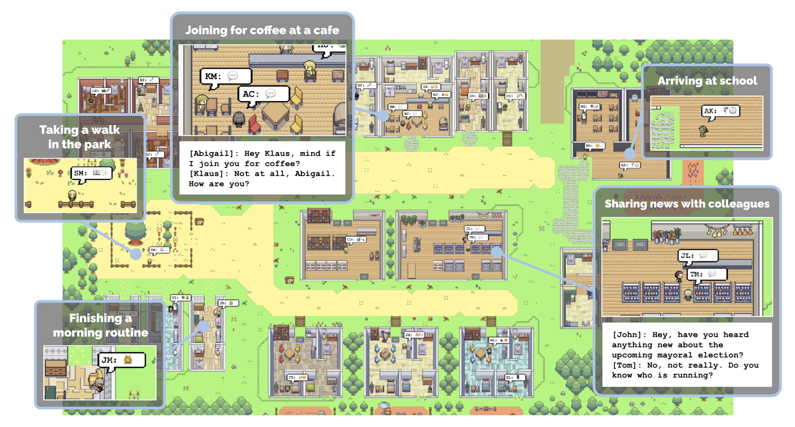
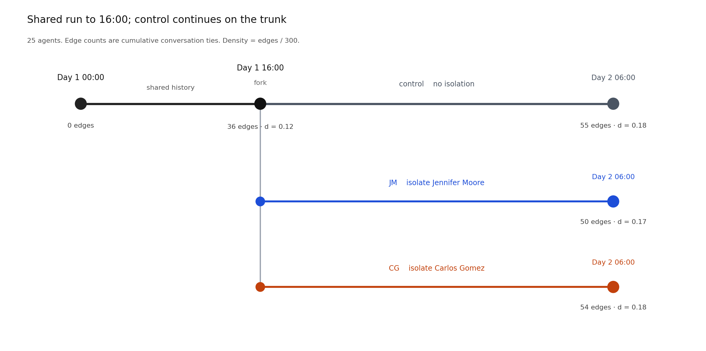

# Network Cognition with Generative Agents

This repository extends [Generative Agents](https://github.com/joonspk-research/generative_agents) (Park, O’Brien, Cai, Morris, Liang, and Bernstein, [UIST 2023](https://arxiv.org/abs/2304.03442)). The original project is a small-town sandbox in which language-model agents plan, remember, talk, and move.

We keep that engine and ask a further question: **what social network do the agents report, and does that report move when the conversation graph changes?**

The full write-up of the current pilot is in [docs/report.md](docs/report.md).

## What the original project is



Park et al. built *generative agents*: computational agents that produce believable daily behavior from a language model, a memory stream, and a planning loop. Agents live on a 2D map (Smallville), perceive nearby people and objects, retrieve memories, write reflections, and start conversations. One game step is ten seconds of simulated time. The paper and demo use a small cast (Isabella, Maria, and Klaus) and a 25-person town. Setup notes for that sandbox are in the [upstream README](https://github.com/joonspk-research/generative_agents).

## What this repository adds

Each agent is asked for a picture of the town’s social network. We compare that picture with the conversation graph that actually formed, then isolate a named person and ask whether the reports follow the new graph.

Additions to the original codebase:

- A **25-agent midnight-pilot** runner (`reverie/backend_server/run_midnight_pilot.py`) with a fixed clock, seed, model lock, snapshots, and recovery.
- **CSS surveys** (`measure_css_survey.py`, version `cumulative-tie-uncertainty-v2`). Every agent judges all 300 unordered pairs (`tie` 0/1 plus a separate `uncertain` flag), then ranks people by degree and brokerage and reports a community partition. Scoring truth is the cumulative conversation graph.
- **Soft-isolation branches** (`run_isolation_branch.py`). At a chosen clock time the run forks. The isolated person still moves, perceives, plans, and writes memory, but neither side can start a new conversation. Chats already under way are kept.

A pair marked `tie = 1` is a judgment of *connection*, not a claim that the two people talked. Biography and housemate ties can differ from observed conversation. Failed survey items stay missing; they are not scored as “no tie.”

## Current experiment



Twenty-five agents share history from Day 1 00:00 to 16:00. At 16:00 the same state splits into three arms, each run to Day 2 06:00:

| Arm | Treatment |
|---|---|
| **control** | No isolation. This is the trunk after 16:00. |
| **JM** | Soft-isolate Jennifer Moore. |
| **CG** | Soft-isolate Carlos Gomez. |

Jennifer was the unique betweenness maximum at the fork; Jennifer and Carlos were the top two by degree. Isolation did change the conversation graph. On the CSS survey, the two isolation arms did not separate from control in any clear way: agents missed most true conversation edges, marked almost every pair uncertain, and usually ranked themselves first. See [docs/report.md](docs/report.md) for tables and limits.

This fork point was chosen after the fact. The original plan was to lock a hub and a broker in a later night window; that window never produced two distinct, stable targets.

## Repository layout

| Path | Purpose |
|---|---|
| `reverie/backend_server/` | Simulation engine, pilot runners, surveys, and tests |
| `reverie/backend_server/persona/prompt_template/` | Agent prompts |
| `environment/frontend_server/` | Django map server and sprites |
| `environment/frontend_server/storage/base_the_ville_n25/` | 25-agent template |
| `environment/frontend_server/storage/base_the_ville_isabella_maria_klaus/` | Original 3-agent template |
| `docs/report.md` | English pilot report |
| `requirements.txt` / `requirements-pilot.txt` | Dependencies |

The `base_*` folders are initialization templates, not experiment results. Snapshots, API logs, and credentials are not in this repository.

## Getting started

**Original Smallville demo.** Follow the [upstream README](https://github.com/joonspk-research/generative_agents): put an OpenAI key in `reverie/backend_server/utils.py`, start Django from `environment/frontend_server` (`python manage.py runserver`), then run `python reverie.py` from `reverie/backend_server`. Upstream tested Python 3.9.12.

**This fork.** Store credentials in `.env` rather than committing keys. Network-cognition runs use Python 3.11, `PYTHONHASHSEED=104729`, chat model `gpt-6-luna`, and embeddings `text-embedding-3-small`. Install `requirements.txt` plus `requirements-pilot.txt`.

```bash
PYTHONHASHSEED=104729 OPENAI_MODEL=gpt-6-luna python3 \
  -m pytest -q reverie/backend_server/tests

PYTHONHASHSEED=104729 OPENAI_MODEL=gpt-6-luna python3 \
  reverie/backend_server/run_midnight_pilot.py describe
```

`describe` does not call the API. A full behavior run and the CSS surveys do.

## Citation

If you use the simulation infrastructure, please cite Park et al.:

```
@inproceedings{Park2023GenerativeAgents,
  author    = {Park, Joon Sung and O'Brien, Joseph C. and Cai, Carrie J. and Morris, Meredith Ringel and Liang, Percy and Bernstein, Michael S.},
  title     = {Generative Agents: Interactive Simulacra of Human Behavior},
  year      = {2023},
  publisher = {Association for Computing Machinery},
  address   = {New York, NY, USA},
  booktitle = {In the 36th Annual ACM Symposium on User Interface Software and Technology (UIST '23)},
  series    = {UIST '23}
}
```

Game assets: background art by [PixyMoon](https://twitter.com/_PixyMoon_), furniture/interior design by [LimeZu](https://twitter.com/lime_px), character design by [ぴぽ](https://twitter.com/pipohi).

## License

Apache-2.0, same as the upstream Generative Agents code.
