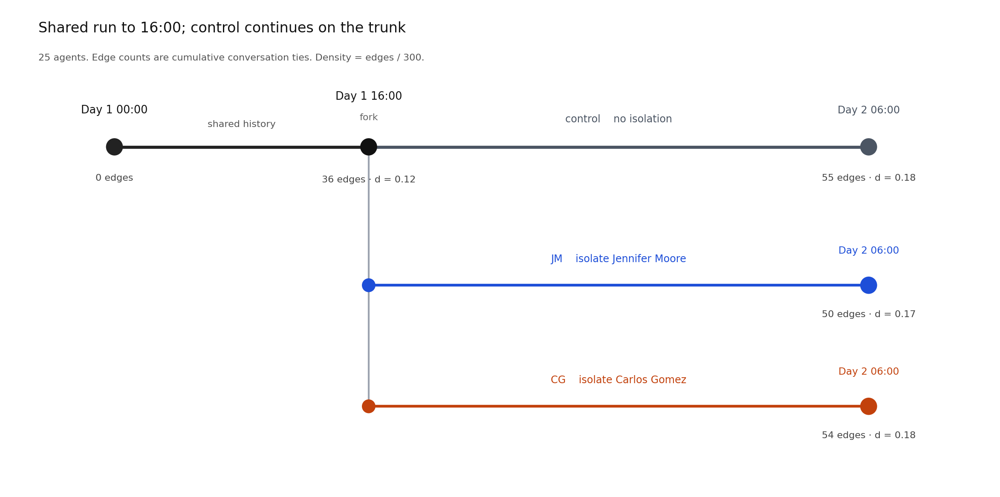

# Generative-agent network cognition: pilot report

**Model** gpt-6-luna · **seed** 104729  
**Survey** cumulative-tie-uncertainty-v2 · **scoring** css-binary-uncertainty-v1

Soft isolation from Day 1 16:00 changed the cumulative conversation graph. On the CSS survey, the JM and CG arms did not separate from control in any clear way. Agents missed most true conversation edges (FNR about 0.86–0.91), marked almost every pair uncertain, and, on the ranking items, placed themselves first about eight or nine times out of ten. This is one trajectory per arm and three survey repeats. It is not a significance test.

---

## 1. Design

Twenty-five generative agents live in one small town. Day 1 00:00 to 16:00 is shared history. After 16:00 (step 5760), the unmanipulated continuation is **control**. Control, JM, and CG all run to Day 2 06:00 (step 10800). Ties form through conversation. The scoring graph is the undirected cumulative conversation network up to the snapshot, with all 25 people kept on the roster. Density uses the 25-person denominator \(25\times24/2=300\).

The original plan was to lock a hub (highest degree) and a broker (highest betweenness) in a window from Day 1 20:00 to Day 2 08:00. All 25 checks in that window failed: both roles often landed on the same person, Jennifer Moore. Day 1 16:00 was then chosen **after the fact** as the fork. That is not a lock from the original rule.

The shared 16:00 state was replayed 720 steps from a 14:00 snapshot of an unforked run. That unforked run used a different survey after 16:00; this report does not use it. After replay, Jennifer was the unique betweenness maximum (0.314), and Jennifer and Carlos Gomez were the top two by degree (9 and 8). Named targets stayed named targets; they were not swapped if ranks later moved.

Three arms start from that one 16:00 state:

| Arm | Treatment | What it does |
|---|---|---|
| **control** | No isolation | The trunk after 16:00; the comparison arm. |
| **JM** | Soft-isolate Jennifer Moore | She still moves, perceives, plans, and writes memory. Neither side can start a new conversation, and react is blocked. Chats already under way are kept. |
| **CG** | Soft-isolate Carlos Gomez | Same rule, Carlos as the target. |

Isolation did block new talk. On the JM arm, the first blocked attempt was Hailey Johnson approaching Jennifer at Day 1 16:19. On the CG arm, Carlos’s own attempt to talk to Latoya Williams was blocked at 16:00:10.

---

## 2. Fork schematic

The figure is a design sketch, not a statistical plot. History is shared until 16:00. After 16:00 the trunk is control; JM and CG fork from the same point. Node labels are cumulative conversation edges and density.

---

## 3. What the survey measures

Each saved measurement snapshot is surveyed **three** times, with 25 respondents per repeat. A child process reads the snapshot and does not write questions or RNG back into the live run. The three repeats estimate survey noise, not between-trajectory variance.

Four instruments share one memory context (up to 50 retrieved memories). The wording has no time window and does not define a connection as “they talked.” Scoring truth remains the cumulative conversation graph, so biography, coworkers, or housemates who never talked in the simulation count as false positives relative to interaction, not as proof that social knowledge is wrong.

| Item | Response | Scores against conversation truth |
|---|---|---|
| 300 unordered pairs: is there a connection? | `tie` 0/1 and `uncertain` true/false per pair | accuracy, precision, recall (TPR), FPR, FNR; pair coverage |
| Who is tied to the most people? | Degree ranking of 25 | Kendall τ-b |
| Who lies on shortest paths between others? | Broker ranking of 25 | Kendall τ-b |
| Communities | A partition | ARI and NMI vs weighted Louvain, seed 42 |

Failed pair items are stored as `null` and are **not** scored as tie = 0. Classification rates below use valid pairs only and should be read with coverage. The Day 1 00:00 snapshot is collected but not scored for accuracy.

Post-fork survey times: 16:00 (once, shared), 18:00, 22:00, 02:00, 06:00. Three repeats × 25 respondents at each time on each arm.

---

## 4. After the fork, the graph itself moved

The treatment shows up first in structure. The isolated person’s degree freezes. Other people’s edges keep growing until about 22:00, then the night graph barely moves.

| Time | Arm | Edges | Density | Jennifer degree | Carlos degree | Jennifer betweenness | Carlos betweenness |
|---|---|---:|---:|---:|---:|---:|---:|
| 16:00 shared | checkpoint | 36 | 0.120 | 9 | 8 | 0.314 | 0.173 |
| 18:00 | control | 40 | 0.133 | 9 | 10 | 0.350 | 0.306 |
| 18:00 | JM | 41 | 0.137 | **9 (frozen)** | 9 | 0.314 | 0.223 |
| 18:00 | CG | 38 | 0.127 | 9 | **8 (frozen)** | 0.379 | 0.194 |
| 22:00 | control | 54 | 0.180 | 9 | 11 | 0.316 | 0.289 |
| 22:00 | JM | 50 | 0.167 | 9 | 9 | 0.349 | 0.214 |
| 22:00 | CG | 54 | 0.180 | 11 | 8 | **0.427** | 0.120 |
| 06:00 | control | 55 | 0.183 | 9 | 11 | 0.309 | 0.289 |
| 06:00 | JM | 50 | 0.167 | 9 | 9 | 0.349 | 0.214 |
| 06:00 | CG | 54 | 0.180 | 11 | 8 | 0.427 | 0.120 |

02:00 matches 22:00. Isolating Carlos raises Jennifer’s betweenness to 0.427. Isolating Jennifer leaves the whole graph sparser than control (50 vs 55 edges).

---

## 5. Post-fork surveys: JM / CG vs control

Values are means across three repeats of 25 respondents. Recall is TPR. Rank 1 is most central; a larger rank number is less central.

### 5.1 Pair item: is there a connection?

| Time | Arm | Coverage | Accuracy | Precision | Recall (TPR) | FPR | FNR |
|---|---|---:|---:|---:|---:|---:|---:|
| 16:00 shared | checkpoint | 0.718 | 0.868 | 0.375 | 0.144 | 0.039 | 0.856 |
| 18:00 | control | 0.727 | 0.848 | 0.353 | 0.138 | 0.049 | 0.862 |
| 18:00 | JM | 0.720 | 0.852 | 0.340 | 0.121 | 0.039 | 0.879 |
| 18:00 | CG | 0.727 | 0.849 | 0.299 | 0.134 | 0.055 | 0.866 |
| 22:00 | control | 0.733 | 0.795 | 0.388 | 0.127 | 0.060 | 0.873 |
| 22:00 | JM | 0.727 | 0.806 | 0.378 | 0.117 | 0.055 | 0.883 |
| 22:00 | CG | 0.747 | 0.808 | 0.385 | 0.097 | 0.042 | 0.903 |
| 02:00 | control | 0.724 | 0.806 | 0.393 | 0.106 | 0.040 | 0.894 |
| 02:00 | JM | 0.716 | 0.809 | 0.385 | 0.120 | 0.049 | 0.880 |
| 02:00 | CG | 0.700 | 0.812 | 0.420 | 0.094 | 0.035 | 0.906 |
| 06:00 | control | 0.729 | 0.806 | 0.365 | 0.101 | 0.038 | 0.899 |
| 06:00 | JM | 0.731 | 0.808 | 0.389 | 0.121 | 0.051 | 0.879 |
| 06:00 | CG | 0.724 | 0.812 | 0.432 | 0.094 | 0.034 | 0.906 |

FNR stays in 0.86–0.91 on every arm; FPR stays in 0.03–0.06. Accuracy looks high because the true graph is sparse and true negatives dominate, not because conversation edges were recovered. At 06:00, JM recall differs from control by 0.02; CG is lower (0.094 vs 0.101). Those gaps are small next to the shared pattern of missing about nine in ten true edges.

### 5.2 Direct ranks, communities, uncertainty

| Time | Arm | Degree τ-b | Broker τ-b | Community ARI | Community NMI | Uncertain fraction | Mean Jennifer broker rank |
|---|---|---:|---:|---:|---:|---:|---:|
| 16:00 shared | checkpoint | 0.170 | 0.080 | 0.071 | 0.668 | 0.966 | 8.2 |
| 18:00 | control | 0.216 | 0.081 | 0.057 | 0.589 | 0.963 | 6.8 |
| 18:00 | JM | 0.182 | 0.082 | 0.060 | 0.607 | 0.963 | 6.5 |
| 18:00 | CG | 0.188 | 0.093 | 0.059 | 0.599 | 0.964 | 6.4 |
| 22:00 | control | 0.189 | 0.141 | 0.048 | 0.572 | 0.967 | 7.5 |
| 22:00 | JM | 0.248 | 0.161 | 0.041 | 0.507 | 0.962 | 7.8 |
| 22:00 | CG | 0.211 | 0.126 | 0.056 | 0.590 | 0.965 | 7.0 |
| 02:00 | control | 0.213 | 0.141 | 0.065 | 0.619 | 0.965 | 7.6 |
| 02:00 | JM | 0.255 | 0.167 | 0.041 | 0.504 | 0.958 | 7.3 |
| 02:00 | CG | 0.215 | 0.128 | 0.061 | 0.563 | 0.968 | 6.8 |
| 06:00 | control | 0.212 | 0.143 | 0.060 | 0.620 | 0.966 | 7.6 |
| 06:00 | JM | 0.250 | 0.167 | 0.045 | 0.505 | 0.963 | 7.1 |
| 06:00 | CG | 0.214 | 0.127 | 0.058 | 0.569 | 0.969 | 6.8 |

Jennifer is almost always the unique true betweenness maximum. On the broker item her mean rank is about 7, not 1. Arm differences are about half a rank; within a wave, individual ranks often run from 1 to 17.

Community NMI falls to about 0.50 after isolating Jennifer, while control stays around 0.57–0.62. That is one of the few arm gaps in the survey tables. With one trajectory and three survey repeats, it is noted, not treated as a confirmed treatment effect.

---

## 6. Regularities in the tables

1. **False negatives dominate.** Of valid pair judgments, about 86%–91% of true conversation edges are reported as 0. False positives stay low. Agents rarely say “connected”; when they do, missed true edges far outnumber extra false ones.
2. **Accuracy is misleading.** The 0.868 at 16:00 is mostly true negatives. Recall is 0.14 and later a bit lower.
3. **Uncertainty is the default.** The uncertain fraction is about 0.96. The small confident subset has a *higher* error rate against conversation truth. The flag is not calibrated confidence.
4. **About 28% of pair slots fail the format check.** Coverage is about 0.72. Failures are not scored as absent edges.
5. **Direct ranks are self-first.** About 80%–90% of respondents put themselves first on both degree and broker. That flattens τ and pushes Jennifer’s mean rank down the list.
6. **Night surveys mostly remeasure 22:00.** Structure and survey scores freeze after 22:00.

---

## 7. How they perceive the social network

### How do they form these reports?

The answers do not look like a conversation graph that updates with history. They look like a sparse, self-centered set of connection judgments, mixed with biography and housemate ties, with almost every pair marked uncertain. On the pair item they miss most conversations that actually happened. On the ranking items they often write themselves first, then an unstable list of others; Jennifer, the true broker, averages about 7th. Frequent “yes” pairs include some true conversation edges (Carlos–Sam, Eddy–John) and some pairs that are often absent from the conversation graph (Francisco–Maria, Giorgio–Isabella).

### What regularities show up?

- Against conversation truth: **high miss rate, low false-alarm rate, high uncertainty**.
- For centrality: strong self-ranking; unstable global broker rank.
- Over time: the daytime graph grows; the survey shape barely moves. After 22:00, structure and surveys freeze together.
- Repeat SDs are small (FNR repeat SD is about 0.01). Weak alignment is stable, not a one-off survey draw.

### After the shock, did perception change?

The graph changed. The survey summaries did not track who was isolated. FNR, FPR, recall, and Jennifer’s broker rank stay close across JM, CG, and control. That is not evidence that agents “identified” the isolated person, and it is not proof that no local memory moved — only that these CSS totals did not follow the structural shock. Lower community NMI on the Jennifer arm remains a question for more trajectories.

### How does this differ from human network cognition?

Human cognitive social structures are also each person’s report of the whole graph, not the graph itself (Krackhardt, 1987, *Social Networks*). People also put themselves too close to the center of the network they report (Kumbasar, Romney, & Batchelder, 1994, *American Journal of Sociology*). The resemblance is qualitative: self-focus, weak global brokerage, and mixing of role or housemate ties with observed interaction.

The scale and the updating differ. People who live in a group usually do not miss about nine in ten observed interaction edges, and they do not mark about 96% of pairs uncertain. They often name some high-degree others, not only themselves. When a frequently seen person drops out of daily contact, local reports often move; here, isolating Jennifer or Carlos did not move the survey totals.

This pilot does not show that generative agents and humans use the same mechanism, and it is not a human sample. It is one model (gpt-6-luna), one 25-person town, and a conversation-graph scoring rule.

---

## Limits

- The 16:00 fork was chosen after seeing an earlier unforked run, not by the original hub/broker lock.
- One behavior trajectory per arm; three repeats estimate survey noise only.
- No significance tests on arm gaps. The tables are descriptive.
- Truth is the cumulative conversation graph, not “social knowledge.”
- All three arms stop at Day 2 06:00.
- About 28% of pair items fail format checks; missing is not scored as 0.

Raw snapshots and respondent files are not published with this repository. The numbers above are wave means across three survey repeats.
